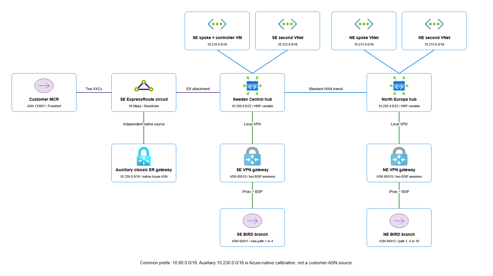
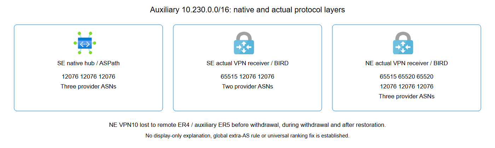

# Virtual WAN: controlled HRP and custom-table calibration

Actual Azure and Megaport control-plane observations from November 14, 2026,
for [erjosito/vwan-visual-topology#9](https://github.com/erjosito/vwan-visual-topology/issues/9)
and [erjosito/vwan-visual-topology#22](https://github.com/erjosito/vwan-visual-topology/issues/22).
This is a deliberately bounded calibration, **not a universal Azure routing
conformance certificate or a packet-delivery test**.

## Executive findings

- Under ASPath preference, North Europe selected remote customer ER path
  `65520-65520-12076-133937` and remote Azure-native auxiliary ER path
  `65520-65520-12076-12076-12076` over positively observed local VPN paths of
  length ten. Withdrawal and exact source restoration repeated those winners.
  These strict-shorter results support the simulator's existing selection in
  these cells; no ranking rewrite is justified.
- The first Sweden Central VPN-preference cell selected the common ER route
  despite established local VPN sessions and positively observed VPN4 input.
  Withdrawing only the customer common static made that same prefix selectable
  via VPN4; restoring the customer statics did not immediately restore its prior
  ER winner. The experiment establishes input availability and history
  dependence, but does **not** reveal complete simultaneous hub-stage
  eligibility or a general deterministic root cause.
- The Azure-native auxiliary prefix had native SE path length two under VPN/ER
  preference and three under ASPath, while the local actual VPN receiver
  retained two provider ASNs. The remote actual VPN receiver carried **three**
  provider ASNs. This is not safely reducible to a display-only anomaly or a
  generic extra-provider-AS rule.
- The actual customer boundary positively received direct VNet, local VPN and
  remote VPN private-only routes with leading path `12076` in the reported
  peer/direction cells. Missing peer entries are not suppression proof; these
  observations do not newly certify mixed public/private ASN vendor behavior.
- Custom red/blue, normalized-empty, None, missing-origin-label and shared-source
  controls are captured from both actual hubs. The custom origin-label fallback
  and consistent shared-origin behavior are supported by selected VNet origins;
  unobserved branch/transit scope remains Not assessed.

## Topology and provenance



Editable sources:
[draw.io](diagrams/topology.drawio),
[SVG](diagrams/topology.svg),
[Excalidraw](diagrams/topology.excalidraw),
[Mermaid](diagrams/topology.mmd).
Official Azure icons are fitted to the same 64-pixel footprint without
stretching their native proportions.

| Component | Configuration |
| --- | --- |
| Standard WAN | Sweden Central and North Europe hubs, two routing infrastructure units each |
| SE / NE hub prefixes | `10.250.0.0/22` / `10.250.4.0/22` |
| VPN inputs | One scale-one VPN gateway per hub; ASN `65515`; two established BIRD sessions per branch |
| SE / NE BIRD sources | ASNs `65011` / `65012`; common `10.60.0.0/16`, auxiliary `10.230.0.0/16`, unique `10.61.1.0/24` / `10.61.2.0/24` |
| ER customer | Actual Megaport MCR ASN `133937`, Frankfurt; two 50-Mbps VXCs to Stockholm ER |
| ER circuit / hub gateway | SE only, 50 Mbps Standard MeteredData; scale-one hub ER gateway |
| Auxiliary origin | SE classic Standard ER gateway attached to VNet `10.230.0.0/16`; **Azure-native**, not an independent customer ASN |
| SE red / blue VNets | `10.210.0.0/16` / `10.212.0.0/16` |
| NE red / blue VNets | `10.211.0.0/16` / `10.213.0.0/16` |
| Deliberate exclusions | No NE ER circuit, ER gateway, auxiliary gateway or second MCR |

The customer common static uses the respective Azure peer as next hop and is a
control-plane-only synthetic advertisement. A selected route to that prefix
does not establish that a customer endpoint receives packets.

Every mutation was restricted to the isolated task-owned run, checked against
the ownership ledger and bounded by independent cleanup. BIRD configurations
and per-session exports were captured before and after controls. Customer
interface baselines were frozen before writes; updates excluded credentials
and required non-target fields to remain unchanged. A partially applied
withdrawal stopped rather than blindly advancing when the provider omitted
empty `ipRoutes`; read-only diff and explicit guarded resume completed only the
remaining peer.

## HRP controls and observed winners

`VPN4`/`VPN10` count actual ASNs on the wire, including BIRD's automatic local
ASN. Three explicit prepends produce four on the wire; nine produce ten.
The common ER2 is `12076-133937`.

| Frozen source/control | SE common | NE common / auxiliary | Interpretation |
| --- | --- | --- | --- |
| Both VPN4, both hubs VPN preference, customer common present | ER2 | Local VPN4 | Initial SE discrepancy, with positive VPN input rather than presumed input absence |
| Same sources, both customer common statics withdrawn | Local VPN4 | Local VPN4 | Positive alternative selection; provider-reflected common advertisements are distinguished from originating statics |
| Customer statics restored exactly, unchanged VPN4 | Local VPN4 | Local VPN4 | SE did not immediately revert to its earlier ER winner |
| Both VPN4, both hubs ASPath | ER2 | Local VPN4 | Strict-shorter common selection |
| Both VPN4, both hubs ExpressRoute | ER2 | Local VPN4 | Source-preserving preference control |
| Both hubs ASPath, SE VPN4 / NE VPN10 | ER2 | Remote ER4 / remote auxiliary ER5 | Local VPN10 input positively present on both gateway instances |
| Only NE common + auxiliary withdrawn; unique NE VPN10 retained | ER2 | Same remote ER4 / ER5 | No whole-session failure masquerading as prefix withdrawal |
| Exact NE VPN10 configuration restored | ER2 | Same remote ER4 / ER5 | Restoration and positive input proof repeat the strict-shorter result |

NE restored configuration SHA-256:
`334873746238200bab29ed129e90627d1f91577b98fc1bc710153622730fe551`.
The NE ten configuration was restored byte-for-byte. Raw export timestamps for
the re-added static routes legitimately changed; export semantics, not raw
export bytes, were restored there. Original raw strings were not rewritten.
For HRP/customer changes without BIRD mutation, both configuration and raw
per-session exports remained byte-identical.

### Native path versus actual receiver



[Editable draw.io](diagrams/hrp-layer-comparison.drawio),
[SVG](diagrams/hrp-layer-comparison.svg),
[Mermaid](diagrams/hrp-layer-comparison.mmd).

| Prefix / preference / layer | Observed AS path |
| --- | --- |
| SE auxiliary, native hub, VPN or ER preference | `12076-12076` |
| SE auxiliary, native hub, ASPath preference | `12076-12076-12076` |
| SE auxiliary, actual internal VPN gateway input across those cells | `12076-12076` |
| SE auxiliary, actual local BIRD VPN receiver | `65515 12076 12076` |
| NE auxiliary, native hub, ASPath with local VPN10 | `65520-65520-12076-12076-12076` |
| NE auxiliary, actual BIRD VPN receiver | `65515 65520 65520 12076 12076 12076` |
| NE common, actual BIRD VPN receiver | `65515 65520 65520 12076 133937` |

The local and remote protocol strings are both real observations. A single
abstract path does not automatically explain the difference. No global path
normalization, provider-AS insertion or simulator `choose()` change was made
from these results.

The [first-party ASPath note](https://learn.microsoft.com/azure/virtual-wan/about-virtual-hub-routing-preference#route-selection-algorithm-for-virtual-hub)
that remote ER is selected last regardless of path
length conflicts with its own example and these strict-shorter NE10 controls.
The evidence does not justify changing the engine to enforce that prose.

### Customer evidence and route reflection

Both actual customer peers were established for the RECEIVED and ADVERTISED
captures. Positives include direct local VNet routes with `12076` on both peers,
and local/remote VPN private-only routes with `12076` on peer zero. Do not infer
suppression from an omitted peer-one entry.

An originating customer static has source `0.0.0.0`, weight `32768` and an empty
pre-local-AS path. An Azure-learned reflection has the Azure source peer,
weight zero and path `12076`. During withdrawal, peer one's ADVERTISED common
could reflect a route learned from Azure on peer zero; that is not evidence
that the deleted originating static survived.

## Native diagnostic boundaries

The registered VPN `getBgpPeerStatus` and `getLearnedRoutes` actions succeeded
with API `2024-10-01` and positively exposed local inputs on both instances.
`getAdvertisedRoutes` was not supported in the tested environment and was
removed rather than retried unchanged.

The registered hub `inboundRoutes`/`outboundRoutes` actions were also probed
for actual SE VPN and ER connection IDs with bodies
`{"resourceUri":"<actual connection ID>","connectionType":"VpnConnection"}` or
`ExpressRouteConnection`. All four calls returned HTTP 200 with empty `value`.
These are effective **route-map** diagnostics, not a complete internal
eligibility RIB. They provide no withdrawal, exclusion or root-cause proof.

## Custom-table controls

The prospective control contract was published before mutation:
[erjosito/vwan-visual-topology#22 control contract](https://github.com/erjosito/vwan-visual-topology/issues/22#issuecomment-6876555234).

Native `default` and explicit `Default` labels are retained as distinct,
case-sensitive payload strings. Red and blue source connections associate
with and propagate to their respective local table ID and label.

| Control | Native acceptance / selected VNet origins |
| --- | --- |
| Red/blue baseline in both regions | Confirmed child `Succeeded`; red tables contain SE red + NE red, blue tables contain SE blue + NE blue |
| NE red association with explicitly empty propagation request | Azure accepted then normalized to Default table ID and lowercase `default` label; NE red prefix moved to Default locally and remotely, while association remained red. This is **not** a confirmed native explicit-empty configuration. |
| NE red association with None propagation | Confirmed None ID/lowercase label; the NE red VNet prefix disappears from observed local/remote tables, while positive SE red input remains in NE red. Paired red restoration returns both red origins. |
| SE red origin label absent while source still propagates red | NE red still positively selects the SE red VNet via Remote Hub, while SE red retains its local VNet and no longer selects NE red. This supports custom origin-label fallback, not bypass of destination-label matching. |
| Shared red/blue labels in both regions | Labels alone retain baseline isolation. SE red ID plus shared-label propagation then selects SE red in red/blue tables locally and remotely; NE red does not leak into blue. |
| Paired restorations and final Default restoration | All eleven stable cells passed. Red and shared-source/label restorations return their baseline VNet origins. Final Default tables positively contain all four VNets; custom red/blue tables have explicit native `empty` observations, not missing/failed snapshots. |

The [executed membership/origin checks](checks/context-checks.json) are derived
assertions against the archived native captures, not additional Azure API
responses or end-to-end reachability certificates.

SE Default also positively contains the two local SE VNet prefixes via an
**ExpressRouteGateway** origin, not a VNet-connection origin. Those entries
must not be confused with direct custom-table propagation or used to claim
that table isolation failed. Branch/transit provenance remains unobserved in
the structural importer, so imported end-to-end paths remain Not assessed
even when the VNet-origin membership is useful calibration evidence.

## Reproduction commands and evidence

Use the actual resource IDs of a separately authorized isolated deployment;
published UUIDs and public addresses are pseudonymous, not usable credentials
or deployment targets.

```powershell
# Run once per stable source/control cell.
az network vhub get-effective-routes --subscription <subscription> `
  --resource-group <lab-rg> --name <hub> --resource-type RouteTable `
  --resource-id <actual-hub-table-id> --output json
az network express-route list-route-tables --subscription <subscription> `
  --resource-group <lab-rg> --name <se-circuit> `
  --peering-name AzurePrivatePeering --path primary --output json
# Repeat the MSEE query with --path secondary.
az network vnet-gateway list-learned-routes --subscription <subscription> `
  --resource-group <lab-rg> --name <auxiliary-classic-er-gateway> --output json

# Actual bounded app collector: stable configuration, one owned WAN, fresh file.
.\src\collect-azure-vwan.ps1 -VirtualWanId <actual-owned-wan-id> `
  -OutputFile <fresh-local-file> -IncludeEffectiveRoutes
```

The BIRD source and actual exports are retained inside the route-only JSON
captures. Both customer directions are actual asynchronous per-neighbor
Megaport diagnostics, not a reconstruction from Azure MSEE output.
Source controls changed one variable at a time, used exact expected source
hashes, captured established sessions and restored before the next scenario.
No confidential deployment parameters or managed VPN configuration payloads
are published.

[Evidence manifest](raw-output/manifest.json) lists allowlisted original source
hashes and **published sanitized-byte hashes**. UUIDs, operator product names
and global IPv4 addresses are replaced consistently; lab private prefixes,
AS paths and capture timestamps are retained. Original archived source hashes
are not hashes of transformed public files. Manifest entries, not embedded
original capture hashes, verify published bytes.

## Disposition and limitations

The simulator investigation now has actual originating-source, native RIB, internal
VPN input, both MSEE, auxiliary gateway and real protocol receiver evidence,
including withdrawal and restoration controls. The previously incomplete
NE longer-path cells are complete. Its initial SE VPN-preference eligibility/
history cause remains unresolved at the internal hub-stage boundary.
That limitation is disclosed instead of prescribing an unsupported universal
algorithm fix.

The calibrated app revision is
[`717582042621fb0ee751c5d195ef18df3aad3c2a`](https://github.com/erjosito/vwan-visual-topology/commit/717582042621fb0ee751c5d195ef18df3aad3c2a),
with **446 passing unit tests**, lint/build and
[exact-head CI](https://github.com/erjosito/vwan-visual-topology/actions/runs/43596994429)
covering both collector suites, generated Bicep and the browser suite.
[The implementation PR](https://github.com/erjosito/vwan-visual-topology/pull/111)
removes only the calibrated custom-origin coverage gate; unknown/remote-only,
conflicting-origin, static and secured/custom boundaries remain conservative.

[erjosito/vwan-visual-topology#111](https://github.com/erjosito/vwan-visual-topology/pull/111) is merged as
[`f4f03de982f3aeb84d55be755f2e80b7c67a222c`](https://github.com/erjosito/vwan-visual-topology/commit/f4f03de982f3aeb84d55be755f2e80b7c67a222c).
[Exact-main CI and deployment](https://github.com/erjosito/vwan-visual-topology/actions/runs/43598731948)
succeeded; static deployment completed at **2026-11-14 13:23:57 UTC**.
[Production checks](checks/production-checks.json) at
https://vwan-simulator.com/ confirmed that exact revision, selectable and
highlighted calibrated custom-origin routing, and preserved reverse-direction
destination-label isolation. Both affected production browser tests passed,
including English/Japanese unknown-context explanations. The collector from
the actual UI download link matches the merged source byte for byte, SHA-256
`8aa0e38601fd4acf2d0fa5bb59ea7367b8b7367f3707114e5a6fa99c81ca5602`.

The separate architecture plan for
[erjosito/vwan-visual-topology#106](https://github.com/erjosito/vwan-visual-topology/issues/106)
and [erjosito/vwan-visual-topology#112](https://github.com/erjosito/vwan-visual-topology/issues/112)
is documented in
[the authoritative #112 plan](https://github.com/erjosito/vwan-visual-topology/issues/112#issuecomment-6875178770),
including alternatives, critique, dependencies and preparation actions.
No architecture or identity implementation is part of this lab.

## Cleanup

Only task-created resources may be deleted. Cleanup is ordered:
ER connections, private peering, two VXCs, the one MCR, an independent provider
audit, recorded task-created external access references, and finally the
owned resource group. The retained
private Key Vault and pre-existing products are preserved. An independently
armed deadline provides interruption protection.

[Final cleanup verification](checks/cleanup-checks.json) completed at
**2026-11-14 14:24:25 UTC**, before the independently armed 16:03 UTC deadline.
All three exact-owned provider products (one MCR2 and two VXCs) were
independently verified **DECOMMISSIONED**, with zero pending provider orders,
before revoking credential access.

The owned Azure resource group is absent according to both Azure CLI and
an independent ARM read. Its final inventory contained 41 tagged task
resources and three generated extensions belonging to the task-created VMs.
All three recorded task-created grants (two secret-scoped grants and the
resource-group Contributor grant) and the one owned vault-side endpoint
reference are absent. The pre-existing Key Vault still exists and its
public network access remains **Disabled**. Deletion was restricted to
verified task-created resources and their generated children.

## References and icon attribution

- [Virtual hub routing preference](https://learn.microsoft.com/azure/virtual-wan/about-virtual-hub-routing-preference)
- [Virtual hub association, propagation, labels and constraints](https://learn.microsoft.com/azure/virtual-wan/about-virtual-hub-routing)
- [Azure Architecture Icons and permitted diagram use](https://learn.microsoft.com/azure/architecture/icons/) — official Azure icons by Microsoft; native proportions retained.
